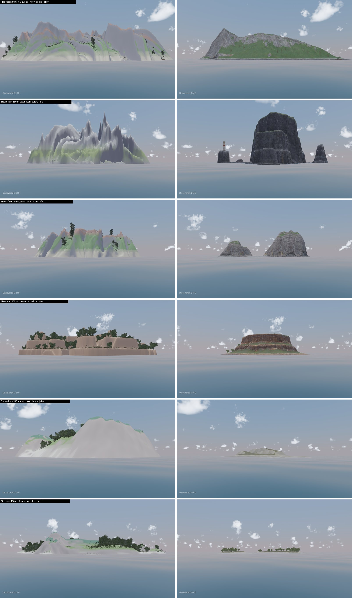

# Generated island height maps: details

The stories, measurements and derivations behind
[generated-island-height-maps.md](generated-island-height-maps.md). From issue #1721, the art
review of *Drift*'s six islands.

## Before and after

The review's captures, BEFORE (base `a0c80c28f`) on the left and AFTER on the right. The cameras
from the boat and from above are the same world-space cameras in both; the on-foot ones stand by
the same rule on the new coast, because the coast is what moved.

- [From the boat, clear noon](../images/drift-islands/from-the-boat-clear-noon.jpg)
- [From above](../images/drift-islands/from-above.jpg)
- [On foot](../images/drift-islands/on-foot.jpg)
- [Storm at dusk, and clear dawn](../images/drift-islands/storm-and-dawn.jpg)
- [The landmarks](../images/drift-islands/landmarks.jpg)

## 1. The scene block is derived data

`tools/drift-islands/build_islands.py` writes four maps per island and, with `--stamp-scene`,
rewrites each island's entity in `Drift.olo` from its header comment to the end of its
`FoliageComponent`, plus the LAYOUT section of the scene's header comment. Everything in those
ranges follows from the recipe: the tile size and height scale from `recipes.TILES`, each layer's
`TilingScale` from the tile size, the landfall radius and the table of peaks and distances from
the height map on disk.

The header's table used to be typed. After the first regeneration it named peaks and distances
that no island had any more, and nothing failed. It is generated now for that reason.

`--check` regenerates every map and compares pixels with the files on disk; it passed on a second
run of all six. The generator is seeded and uses no clock, so a difference means the recipe, numpy
or scipy changed (`requirements.txt` pins the versions the shipped maps were made with).

## 2. What the radial mask could not make

The islands were `TerrainGenerator::GenerateHeightField` with `IslandFalloff: 1`: fBm, a ridged
blend and a domain warp, uniform over the tile, multiplied by one radial mask. The review found,
on the base commit:

- Top-down, all six share one circular outline with a scalloped rim. Atoll had no ring or
  lagoon, Sisters was one blob, Stacks had no stacks.
- The coast was the mask's own ramp. Jolt rays down each island's approach bearing measured the
  slope at the waterline: Dunes 58 degrees, Sisters 55-60, Ridgeback 45-50. Mesa's terracing
  quantised the ramp into a 17 m vertical step, from 7 m under the sea to 10 m above it within
  2 m.
- `ProceduralErosionIterations` was 0 on all six, so there was no drainage, talus or strata.

A mask fixes the tile border (see [terrain-tile-meets-ocean.md](terrain-tile-meets-ocean.md)) and
nothing else: it has no notion of where a spine runs or where sand lies. So the tool draws each
island's character directly, in metres, and derives the rest:

1. **Landform** (`recipes.py`): a polyline spine with separate north and south half-widths
   (Ridgeback), two tilted blocks and a shingle bar (Sisters), tiered superellipse blocks and
   faceted, fluted sea stacks on a platform (Stacks), a caprock, bench and talus (Mesa), transverse
   and crescent dunes aligned to the scene's wind with a spit (Dunes), a ring reef with tapered
   cays and one pass (Atoll).
2. **Erosion** (`erosion.py`): the droplet model `TerrainGenerator::ApplyErosion` uses, with a
   hardness map so a cliff resists and a dune does not, the sea as a sink, and thermal slumping to
   an angle of repose.
3. **Shore, sites, border, materials**: sections 3, 4, 7 and 11.

Two traps in the erosion, both of which showed as a peak that grew instead of wearing down
(Ridgeback reached 154 m from a recipe that tops out at 84):

- Heights were in metres while the model's constants assume a map normalised to its width. The
  tool divides by the map's width in metres before eroding.
- A batch of droplets was applied as if each acted alone. Twenty thousand droplets that share a
  cell each removed the full amount the cell could give. The loop now applies one step for the
  whole batch and shares each cell's change among the droplets standing on it.

## 3. Border and summit

The border rule is the one [terrain-tile-meets-ocean.md](terrain-tile-meets-ocean.md) rule 3
states for the mask, restated for a map: the last pipeline step sets every border texel to exactly
0, after erosion and after the sites, so no later pass can undo it. The test is an equality.

A map stores heights as 16 bits of `HeightScale`. A recipe whose summit reaches the top of that
range is clipped flat with no error anywhere, so `pipeline.generate` raises when the peak does not
fit, and the test asserts the stored maximum is below 1.

The border step drives the last 26 m before the tile's edge to the floor, and inside that ramp the
ground is no longer the recipe's. An island has to finish before it. Ridgeback's east point did
not: land came within 9 m of the edge in the recipe, and the ramp cut the point into a scarp
parallel to the tile's edge, 57 degrees at the waterline against 8 on the rest of the coast. Dunes'
foreshore, which a beach profile carries 34 m out from the waterline, ran into it under water.
Nothing failed: the border was still exactly the floor, and the coast-slope test takes an
island-wide median. `shaping.fits_tile` measures how near the shore (ground less than 3 m under
the sea) comes to each edge, `pipeline.generate` raises when that is inside the ramp, and
`EveryShoreFinishesBeforeTheTilesBorderRamp` checks the shipped maps. The code review found it by
measuring the map; none of 246 captures had made it obvious.

`HeightScale` also sets every foliage altitude band, which are metres above the tile floor: the
sea is at 24.

## 4. The coast is shaped, not left over

`shaping.apply_beaches` pulls ground within a band of the waterline onto an equilibrium profile: a
7 degree foreshore, a berm at 1.6 m, and a 5 to 10 degree nearshore bed. `apply_rock_platform`
cuts a platform of uneven width where the coast is rock. The band's inland reach is per island:
Atoll's cays are only 25 m wide, and the default 18 m reach flattened them to the berm height
(2.1 m), so Atoll uses 7 m.

Measured on the shipped maps, the median slope within 1.5 m above the sea is 6.6 to 9.2 degrees on
every island, cliffs included, because the median is taken over the whole shore band.

## 5. Albedo is physical

The old layers were solid colours picked as display colours: "Scrub" `0.26 / 0.42 / 0.19` and sand
at `0.8-0.92`. The terrain shader consumes `BaseColor` as linear albedo, so Scrub displayed as
sRGB 140/173/120, a mint green, and the sand was brighter than fresh snow. Under the scene's
3.2-intensity sun the islands read as pastel: the mean HSV saturation of the island region at clear
noon was 39 of 255.

`materials.PALETTES` are linear reflectances. `GroundAlbedoIsPhysicalAndNoTwoIslandsShareAPalette`
bounds each island's mean land luminance to 0.03-0.55 (wet basalt to dry coral sand) and requires
every pair of islands to differ, which the copied palettes of the old scene did not (Dunes used
Atoll's four layers verbatim, "Coral rock" on a dune).

## 6. One layer library, six islands

Eight CC0 scans from Poly Haven (`layers.py`, credits in `tools/drift-islands/README.md`) serve all
six islands. Each albedo is rescaled so its mean linear colour is a fixed neutral
(`materials.NEUTRAL`); the macro map then carries `target colour / neutral` per texel. The macro
multiplier's ceiling is 255/128, about two, which is why the neutrals are chosen near the middle
of what the islands need: a white coral sand cannot be reached from a brown one.

The scans download on demand into `.island-source/` (git-ignored) and are checked against the MD5
in `sources.json`. Only the processed 1024 px layers are committed.

## 7. An unclaimed texel is eight textures averaged

The terrain shader normalises the splat weights through its height blend. Where the splatmaps
hold no weight at all, the blend gives every layer a share, and the ground there is the average
of all eight textures. The first bake left 494,645 such texels on Dunes (the seabed deeper than
3.5 m, which no sand rule claimed) and 7 on Atoll. They were under water and nobody saw them; the
map test found them as a weight sum of 0.

`materials._norm` now raises on a texel with no weight instead of dividing by one.

## 8. One orientation for four maps

Image row 0 is the tile's z = 0 edge and column 0 its x = 0 edge, for the height map, both
splatmaps and the macro map. Before #1721 the engine's file path flipped a splatmap vertically and
did not flip a height map, so a splatmap authored beside a height map came out mirrored in z. No
scene had ever loaded a splatmap from a file, so nothing showed it.

## 9. Tiling is repeats across the tile

`TilingScale` used to mean repeats across the tile on flat ground and repeats per metre on a slope
steep enough for the triplanar path: a layer that repeated 40 times across a 200 m tile repeated
8000 times on the slope beside it. It now means repeats across the tile everywhere, so the stamper
writes `tile size / metres per repeat` (`layers.LIBRARY` holds the metres).

Voxel terrain samples a world position in metres, so its draw is given the tile's size beside the
layers' `TilingScale` and the shaders divide per axis (`include/TerrainVoxelTiling.glsl`): X-facing
faces by the tile's Z size, Z-facing faces by its X size, the top by both, which is what the
heightfield's own three projections do. A first version converted once on the CPU with the X size,
so a carved wall on a tile that is not square matched the ground beside it along one axis only.

## 10. The landfall radius

`DriftWeatherDirector.lua` arms a leg 45 m outside each island's coast and reads the coast off the
terrain component: `coast = (ShapingIslandFalloffRadius + 0.5) * 0.5 * WorldSizeX`. That formula
estimated where a radial mask's waterline fell. A height map applies no mask, so the stamper
measures the coast (the 99.5th percentile of the land's distance from the tile centre, so one
awash rock does not set it) and stores the value that makes the formula return it. The component
field carries nothing else on a height-map terrain.

That radius holds ALL of the island, on purpose: a boat beached anywhere on it is inside the ring,
which a mean radius would not give the ends of a long island. The price is on the long sides.
Ridgeback's ring is 182 m and its south shore 110 m from the centre, so a boat sailing at that
shore from the start line makes landfall about 115 m off the beach, where a disc island made it
at 45. The generator prints the mean coast radius beside the stamped one so the difference is
visible when a recipe changes.

## 11. Landmark sites

The harbour crane's landing (Ridgeback) and Stacks Light (Stacks) were placed on whatever the
noise left, then surveyed with Jolt rays: the landing's deck meets ground at 1.31-1.49 m with
3.21 m of water under the hook; the lighthouse's stair foot was meant to meet rock at 28.7 m and
stood on 30.95 m. `recipes.ridgeback_sites` and `recipes.stacks_sites` restate those surveys as
ground the new islands must have, applied after erosion so nothing wears them away.

The landing is stamped with `max(height, apron)` carried inland until it meets the island's own
slope. A first version stamped a fixed rectangle, and the warped coast left it standing in open
water.

Surveyed again on the generated islands, in Play, by the same rays: the deck's edge meets ground
at 1.40-1.41 m, there is 3.19 m of water under the hook and 3.52 m alongside the track, and the
lighthouse's stack top is 28.68-28.70 m across its whole 20 m.

## 12. A height-map terrain off the GPU

Two defects sat on the path no scene had used:

- `Scene.cpp` handed `TerrainComponent::m_HeightmapPath` to the loader as stored. A
  project-relative `Assets/...` path was read against the working directory and not found.
- The decode lived inside `TerrainData::LoadFromFile`, which uploads. A dedicated server or a
  functional test never built CPU heights for a height-map terrain, so it had no collision body:
  `Scene::CpuTerrainHeights` returned false and the builder logged a warning and skipped.

`TerrainData::DecodeHeightmapFile` is the decode alone. The GPU height map is also clamp-to-edge
now: under repeat, the filter at u = 0 took half its weight from the u = 1 edge, which grew a 12 m
wall along the low edge of a test terrain whose edges differed.

## 13. Terrain shadow casters follow the main view's detail

Drift's sun cast shadows to 35 m, so from the boat no island was ever shadowed. Raising the range
showed where terrain shadows cost. Measured in the editor on OpenGL at 1920x1080, six 1024 px
islands, clear morning, with the pass's own `Csm/TerrainCasters` GPU brackets:

| Sun shadow range | Terrain casters before | after |
|---|---|---|
| 35 m | 0.2-1.3 ms | 0.1-0.4 ms |
| 300 m | 4.3-8.5 ms | 0.4-0.9 ms |
| 600 m | 9-15 ms | 0.4-1.1 ms |

Three things were wrong, and the order they were found in is the lesson.

1. **The fixed tessellation.** The shadow submit drew every chunk at a tessellation factor of 4.
   A chunk mesh already has a vertex on every height texel, so that was sixteen times the
   triangles for no added shape. Dropping it to 1 barely moved the time (5.8-17 ms to 4-15 ms),
   which said the cost was not triangles.
2. **The level of detail.** A whole-tile proxy picked by the cascade's texel size was tried and
   never selected: the cascades are 4096 px, so even the last one resolves 0.29 m at a 600 m
   range, finer than the chunks' 0.41 m. Texel size was the wrong yardstick. What bounds useful
   caster detail is the receiver: the main view tessellates terrain to `TargetTriangleSize`
   pixels, so at 118 m its triangles are already 0.76 m long. `TerrainShadowLod::Select` picks,
   per chunk, the coarsest of four index sets (strides of 1, 2, 4 and 8 quads over the same vertex
   buffer) whose quads are no larger than the main view's triangles at the chunk's nearest
   point. That took a fifth off, no more.
3. **The per-draw state.** Each of a terrain's 256 chunks re-uploaded the terrain's 2.3 KB uniform
   block, its instance record and its heap offsets, all identical. Sending them when they change
   is what took 9-15 ms to about 1 ms. A GPU bracket round a draw-call-heavy loop measures the
   submission as much as the drawing.

The levels are not applied under the virtual shadow map, whose cached pages would keep the level
they were drawn at as the camera closed in, nor under displacing snow, which is finer than the
height field.

Two more followed from measuring in Play from the boat instead of from a parked editor camera.

4. **The draw count.** With the uploads gone the GPU time was small and the frame was not: six
   islands were still about 1,500 shadow draws a frame, and the pass's CPU time was 1.7 ms. A
   terrain whose NEAREST point already selects the coarsest level has every chunk there, so it
   casts from one mesh of the whole tile (`TerrainChunkManager::GetShadowTileMesh`): a flat grid
   at the coarsest level's spacing, which the depth shader's evaluation stage displaces like any
   chunk. One draw and one cull replace 256.
5. **The ceiling.** `TerrainShadowCasterEvidenceTest` was written to show the tile mesh casts the
   shadow the chunks cast, and its first run failed: on a 129 px map the tile mesh put a 24 m
   rim's shadow edge at 26.9 m, not 24. The rule compared a caster's quads with the size the pixel
   target ASKS the main view's triangles to be, and the main view cannot draw that coarsely: a
   node is 64 quads a side whatever its level, so its quads stop growing at the root node's. On
   that map (3 chunks a side) the root node draws 1 m quads and a chunk's coarsest mesh was 2.7 m.
   A height read for a coarse vertex is a filtered one (it has to be, or a coarse node undersamples
   the relief), so a caster that much blunter than the drawn ground is also lower at every rim, and
   its shadow shorter. `TerrainShadowLod::CoarsestReceiverQuad` is the ceiling. A tile is
   `ceil(resolution / 64)` chunks a side, so it never binds from 449 samples up, which is why six
   1024 px islands did not show it and a test terrain did.
6. **Tessellation off.** The code review of that test found the same fault by another road. A
   terrain drawn without tessellation shows every vertex at its exact height at any distance, and
   its chunk casters carry those heights too; the tile mesh has none of its own and reads filtered
   ones. So only a tessellated terrain casts from the tile mesh. The test's third arm is that
   terrain, and each arm now asserts how many casters the shadow pass was handed
   (`Renderer3D::GetTerrainShadowCasterCountLastFrame`): one for the tile mesh, one per chunk
   otherwise. Before that, the arm named "TileMesh" proved only that some coarse caster had cast.

## 14. The quadtree split on the wrong size

`TerrainQuadtree::CalculateScreenSpaceError` (and its transcription in `TerrainNodeSelect.comp`)
projected a node's whole world extent to pixels and compared that against `TargetTriangleSize`.
A node is a 64-quad grid, so a node "under 6 pixels" has quads a tenth of a pixel long: every
node split until the tree ran out of levels. Every terrain in view was drawn at its deepest level
at every distance, and the authored target did nothing: 6, 10 and 16 px all measured the same
8.8 ms of depth prepass plus scene pass near a 1024 px island, against 5.4 ms for the 512 px island
it replaced. Cost followed the square of the height map's resolution.

The scale had a second fault. It was `viewProjection[1][1] * viewportHeight / 2`. That element is
the projection's `cot(fovY/2)` times the camera's up axis along world Y, so it shrank as the
camera pitched and was zero looking straight down, where the terrain collapsed to its root node
(the top-down captures were the cheapest frames measured, for this reason). Under Vulkan's flipped
Y it is negative, and a negative error is below every threshold.

Nothing looked wrong, which is why it lasted: over-refined terrain is correct terrain.
`TerrainGPUQuadtree.GpuDescentSelectsTheSameNodesAsTheCpuQuadtree` held the two descents to the
same answer, and they agreed.

`TerrainLodMetric::QuadProjectionScale` is now the one scale: the length of the view-projection's
second row, divided by the node's quads per edge. With it, near Ridgeback at a 6 px target the
depth prepass went 4.3 to 2.2 ms and the scene pass 4.5 to 2.4 ms.

## 15. Fog was computed to the seabed

Each island stood on a straight-edged patch of differently coloured water, strongest in the storm.
The first explanation, a seabed layer paler than the seafloor plane, was wrong: the colours were
matched and the patch stayed. What found it was capturing the frame between passes
(`olo_render_capture_target`): after the water pass the sea was uniform; after the fog pass it was
not.

Water is drawn blended and writes no scene depth. The fog pass rebuilds each pixel's world
position from scene depth, so over the sea it rebuilt the seabed and fogged that. Inside a terrain
tile the floor is near under the surface and the fog was light; outside, the ray ran on to the far
plane and the fog was at its limit. The edge of the patch was the edge of the tile.

`WaterRenderPass` already captures the surface's own depth for the underwater fog. The fog pass
binds it and `include/FogSurfaceDepth.glsl` takes the nearer of the two depths, in the fog shader
and in its upsample. When no water was drawn the pass binds the scene depth to both slots, never the
null resource, whose samples read 0 and would put the whole frame at the near plane. A first version
bound the renderer's white texture there, which is a texture of the renderer's own device: the
Vulkan pass suite, which runs the pass on a device of its own inside the OpenGL test process, read
half the fog it expects, and that failure is what removed the stand-in.

The fix moved the eight overcast and storm goldens of `DriftWeatherVisualEvidenceTest`, the two
night ones past the test's threshold (RMSE 14.6 and 19.7 of 255), which is the change itself and
not drift. From 4.2 m above
the sea the surface ten rows under the horizon is 118 m away and the seabed behind it is past the
far plane, so the old frames fogged the whole sea as if it were at the horizon. A dump of both
depths down one column of the frame settled that before the goldens were rebased.

## 16. Lighting that does not know the level of detail

Once the quadtree drew terrain at its authored triangle size, the relief lighting softened with
distance: the terrain's normal came from the evaluation stage, from height differences at the mip
matching the vertex spacing, interpolated across each triangle. It would also have stepped as a
node changed level.

The fragment stage now reads the height map itself (`include/TerrainPixelNormal.glsl`), at a
fractional mip matching the pixel's footprint, with the differences taken one texel of that mip
apart. The instance's normal matrix reaches it as three flat varyings rather than a block, because
the terrain fragment stage is at the driver's limit of uniform blocks on the bindless route.

## 17. Binary maps in history

The six islands' maps are 8 MiB and the layer library 31 MiB, all plain blobs (not LFS). An art
pass regenerates them many times. Iterate with the maps uncommitted and commit the final set with
the scene that names them.

## 18. Samples and areas

The engine read one height map two ways. `TerrainData::GetHeightAt` maps a normalized coordinate
onto the texel index range [0, N-1] and lerps between texels: N samples, N - 1 intervals, the
first and last on the tile's edges. The collision shape, the chunk meshes, foliage placement and
the picker all follow it. The terrain shaders handed the tile UV to `textureLod`, which reads a
texel as an area centred half a texel in from the edge: N texels, N intervals. The two disagree by
(u - 0.5) texels: nothing at the middle of a tile, half a texel at its edges. On the 256 px, 260 m
terrains Drift had before this work that was half a metre sideways between the drawn ground and
the ground a body stands on, and on a 45 degree slope as much up or down.

It had been seen before and stepped round. The GPU picker's shader carried a comment saying it
transcribes `GetHeightAt` with `texelFetch` because a bilinear fetch "works in the texel-centre
convention", and that it "leaves the rendering path's convention alone". The code review of the
island generator found it a third time, as two texel-to-metre factors in one Python file (`size /
n` and `size / (n - 1)`), each right for one of the engine's two readings.

`include/TerrainHeightUV.glsl` converts a tile UV to the coordinate whose bilinear fetch is the
CPU's lerp, `(uv * (N - 1) + 0.5) / N`. It is the same at every mip of a power-of-two map, because
mip m's texel j is the mean of base samples centred at `j * 2^m + (2^m - 1) / 2`. Every fetch of the
height map by a tile UV goes through it: the evaluation stages' helper, the per-pixel normal and
the virtual-texture bake.

`TerrainHeightSampleConventionTest` renders a 17 px height map (4 m between samples, so half a
texel is 2 m) straight down, unprojects every pixel's depth and compares the height with
`GetHeightAt` at that point: 0.2 mm rms on OpenGL, 0.6 mm on Vulkan, on all three paths. With the
conversion removed the same frame is 1.06 m rms from `GetHeightAt` and 0.05 m from the area rule
evaluated on the CPU, which is what says the old behaviour was that rule and nothing else. A
second case counts the fetches per shader file, so one added without the conversion fails.

A splatmap and a macro map are the other kind: painted areas, read at texel centres, and left as
they were. The generator therefore works on the sample grid (`fields.xz`, `fields.cell`) and moves
everything it paints to texel centres before quantising (`fields.to_areas`), so a tide line is on
the ground it was computed for and not up to half a texel beside it.
