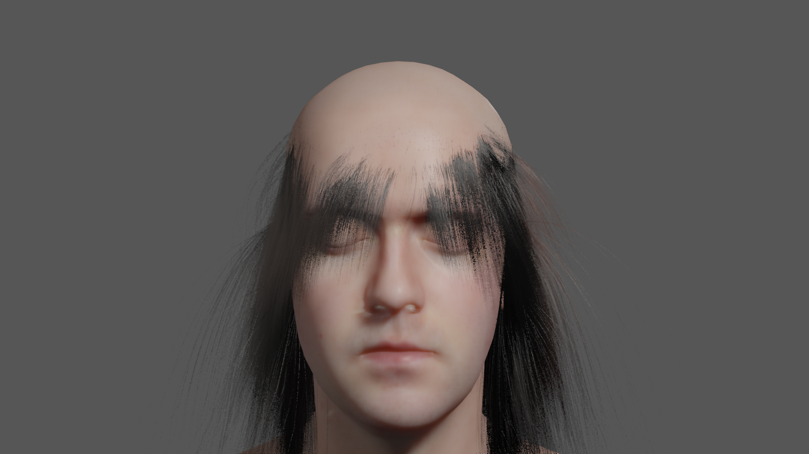
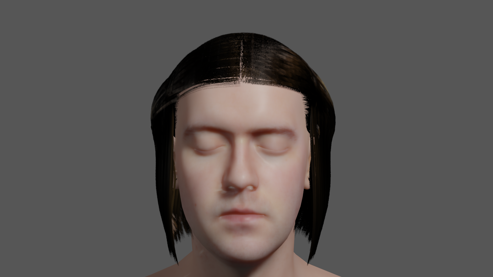
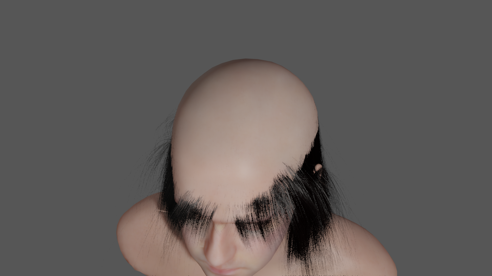
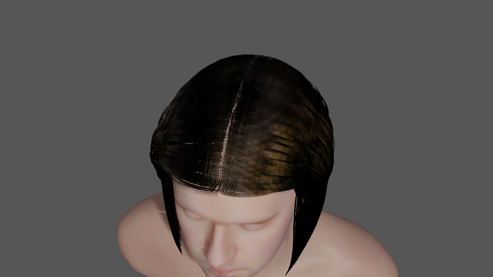
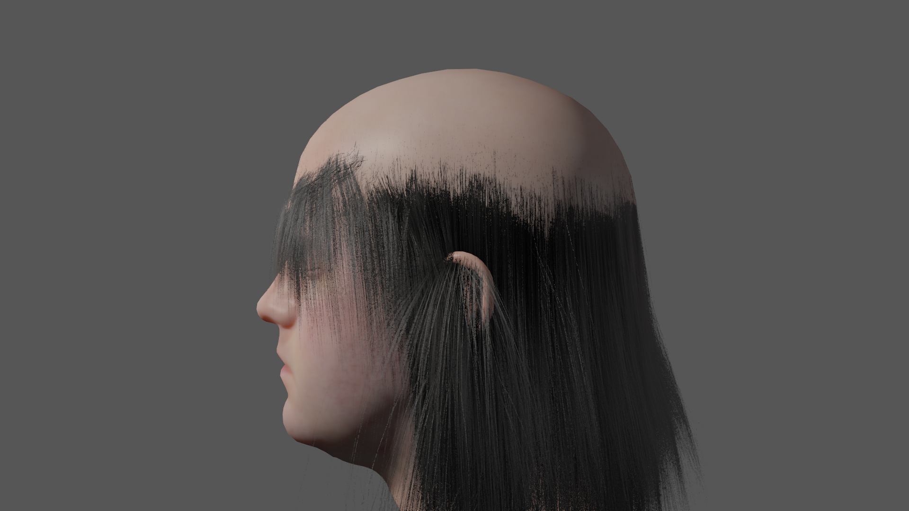
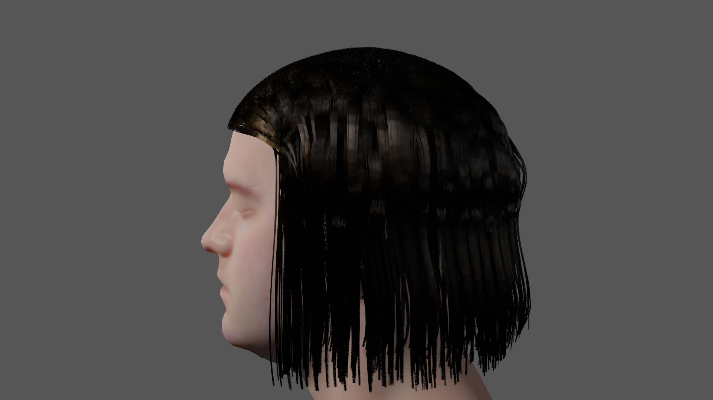

# Inspect the authored bob in native frames and motion

Review the hairline, part, locks and highlights in the images below before deciding
whether #1593 meets the programme's visual bar. Binding, coverage and finite-value
contracts cannot decide that. The authored bob replaces the old face-covering veil
with swept scalp curves, a visible centre part and jaw-length locks above the shoulders.
Its highlights retain the physical R/TT/TRT lobes. This is an asset/look-development
change; shared shaders, the scan, rig, skin profile and thickness map are unchanged.

| Original shipping asset | Authored asset, same native GL fixture |
|---|---|
|  |  |
|  |  |
|  |  |

The native still A/B holds pose, camera, lights and rendering settings constant.
The baseline uses its shipping fibre/simulation settings; the authored side uses
the final settings, so this compares the delivered packages, not geometry alone.
[Three-quarter](../testing/evidence/hair1593/GL-threequarter.webp),
[backlit](../testing/evidence/hair1593/GL-backlit.webp),
[Vulkan crown](../testing/evidence/hair1593/VK-deferred-crown.webp) and
[Vulkan hybrid](../testing/evidence/hair1593/VK-hybrid.webp) expose other views.

The scalp is populated through the turns and nod; the face stays readable and the
tips separate above the shoulders. The root edge and centre part remain conspicuous
at the closest crown framing, and the side locks are deliberately ordered waves.
These are the aspects that need the strongest visual second opinion. This report
does not declare film-quality acceptance from strand counts or passing tests.
Closed eyes and oral geometry remain #1402; the wider acceptance gate remains #1259.

## Authoring and look development

The reference and reproduction commands live with the
[human source](../../OloEditor/SandboxProject/Assets/Grooms/HumanSource/README.md).
Python 3.13.7 / Blender 5.2.2 LTS authors roots on the actual glTF's triangles,
interpolated UVs, a frontal hairline, ear clearance and a narrow part. Voronoi locks
follow the scalp into tangent-continuous hanging sections with curved, varied tips.
Non-root controls are projected out of the scanned surface; the ellipsoid supplies
styling direction only. Root diameters are tapered 65–95 micrometres.

The final recipe contains 88,974 strands, 32 arc-length-sampled controls per strand,
594 guides and 4,454 cooked cards. Repeating authoring reproduced the entire recipe
and curve digest. Alembic metadata can vary; the curve digest is the geometry oracle.
The real Alembic importer/cooker/binding builder produced the installed pair, with
no import warnings. Existing registry handles are preserved. SHA-256 identities
and byte sizes are in [verification.json](../testing/evidence/hair1593/verification.json).

Fibre settings are eumelanin 0.5, pheomelanin 0.1, longitudinal roughness 0.18,
azimuthal roughness 0.22 and intensity 1. The old intensity 3 amplified a broad
uncoloured sheen. The R lobe remains present; no brown tint or lobe removal was
added to shared shading. Separate [R](../testing/evidence/hair1593/GL-lobe-1.webp),
[TT](../testing/evidence/hair1593/GL-lobe-2.webp),
[TRT](../testing/evidence/hair1593/GL-lobe-3.webp) and
[multiple-scattering](../testing/evidence/hair1593/GL-lobe-6.webp) captures are retained.

An early static groom looked covered but sagged through the scalp in runtime.
The final source has 6 mm crown volume and group stiffness scale one. Scene
stiffness 2000, damping 12 and gravity `[0, -4, 0]` retain full simulation and
collision within the solver's supported ranges. See the
[runtime clearance lesson](../agent-rules/groom-runtime-scalp-clearance.md).
Only HumanCoat changes in GroomAnimals and generated Acceptance; the acceptance
manifests carry the regenerated scene digest. No dog/breed sources were regenerated.

## Executed matrix

Captured 2026-10-11/12 on Windows 11 Pro 10.0.22631, i7-14700KF, 64 GiB RAM,
RTX 4090 (24,564 MiB), driver 617.14. Fresh `dev-cached-core` clang-cl Release
build, USD disabled, Vulkan SDK 1.4.357.0. Every build used the build-lock wrapper.

| Backend/path | Native views and motion | Resolution, TAA, samples | Upscaling | Distance handover |
|---|---|---|---|---|
| GL Forward | Native fixture + live, full clip | 1920×1080 / 1601×901, on/off, actual 1 | FSR1 and FSR2 Quality | Near → cards → far fallback → near |
| GL Forward+ | Same | Same, actual 1 | FSR1 and FSR2 Quality | Same |
| GL Deferred | Same | Both sizes, on/off, actual 1/4 | Dynamic scale unsupported, #1537 | Same |
| Vulkan Forward | Live native, full clip | Both sizes, on/off, actual 1 | FSR1; FSR2 request resolves to FSR1 | Same |
| Vulkan Forward+ | Same | Same, actual 1 | Same | Same |
| Vulkan Deferred | Same | Both sizes, on/off, actual 1/4 | Dynamic scale unsupported, #1537 | Same |
| Vulkan Deferred hybrid RT | Native still + full clip, active proxy/TLAS | Native, TAA on, actual 1 | Native | Strand proxy at close framing |

MSAA 4 was requested in every raster path. The live scene band stays single-sample
in Forward/Forward+; only Deferred reports four samples. Vulkan FSR2 reports
`backendNotOpenGL`, spatial fallback at the requested scale. These are support
results, not successful runs of the requested unsupported modes. Odd native
Deferred resizing was tested independently of dynamic internal scale.

Every raster path also has hair-off and lobe controls. Five held native views
cover front, three-quarter, profile, crown and backlit. The full generated Acceptance
scene was captured at both fixed head cameras on all six raster paths. Its multi-second
frames trigger MCP's stale/liveness threshold; camera changes and frame indices
advance in the ledger. Those captures demonstrate integration, not temporal quality.
Clean, fast head-only scenes retain the same placement and Acceptance lights for
the live quality/motion matrix. The GL fixture separately uses the real Scene pipeline.

The actual LookAround duration is 7.24 seconds. The GL fixture steps the real scene
continuously at 60 Hz through the whole clip. Live Play captures observe and unwrap
the active scene's animation time through at least one full cycle on every path.
[GL](../testing/evidence/hair1593/GL-motion.webp),
[Vulkan](../testing/evidence/hair1593/VK-motion.webp) and
[Vulkan hybrid](../testing/evidence/hair1593/VK-hybrid-motion.webp) are sampled
lossless evidence animations, displaying each sampled frame for 600 ms; they are
not recordings at a claimed playback frame rate. Source stills are native 1080p.

Distances 1.5, 2, 2.4, 4, 20, 40, 2 and 1.5 m exercise both directions.
At 40 m the apparent-size policy requests the shell/mesh tier and truthfully
retains cards: the measured #1252 policy did not select the shell tier. The
fallback reason is retained in the ledger; no forced mesh-success claim is made.

## Delivery, validation and cost

The packed native test round-trips the exact shipping bytes through
AssetPackBuilder and RuntimeAssetManager, preserves its independent skin control,
and verifies live binding/deformation in
[loose](../testing/evidence/hair1593/GL-loose.webp) and
[packed](../testing/evidence/hair1593/GL-packed.webp) native screenshots.
The optional `ExportsHumanHairGame` test uses GameBuildPipeline to produce a
standalone distribution: four packed assets, one scene, staged glTF buffers,
textures and thickness sidecars. A fresh OloRuntime loads that distribution,
deserializes seven entities with zero failures, and loads all three render assets
from the pack. Its [native client capture](../testing/evidence/hair1593/runtime-cold.webp)
uses DPI-aware PrintWindow and shows simulation running on the packed hair.
The same cold distribution was also inspected on Vulkan in a
[native runtime capture](../testing/evidence/hair1593/runtime-cold-VK.webp).

The validation-enabled Vulkan editor loaded `VK_LAYER_KHRONOS_validation` with
core/synchronization validation and emitted zero VUIDs during the native, edge,
LOD and full motion campaigns. The hybrid path reported one complete groom proxy,
735,568 resident triangles, 55,903,168 proxy bytes, two TLAS instances, three
ray-traced lights and zero light fallbacks. Motion captures retain fresh RT stats.
This proves caster participation; it does not add RT mask reception to groom shading.
Release shader introspection is compiled out, so logs provide shader diagnostics.
No head-scene shader compile/link error or binding refusal was observed. The full
Acceptance scene repeats its baseline Fox version-4 asset refusals; those assets
are unchanged and belong to the broader acceptance work.

Fresh editor cost observations used a held native three-quarter head, TAA on,
MSAA 1, native scale, unchanged lights and no competing engine build/test/runtime.
Vulkan validation was disabled. Each path has 24 unique valid GPU frame samples,
complete pass attribution, and a host process record. These samples are descriptive,
not paired run-level regression confidence intervals.

| Backend/path | Frame median ms | CPU median ms | GroomPass GPU median ms | GroomPass CPU dispatch median ms |
|---|---:|---:|---:|---:|
| GL Forward | 34.48 | 33.18 | 8.55 | 30.32 |
| GL Forward+ | 35.11 | 33.69 | 30.20 | 30.72 |
| GL Deferred | 35.00 | 33.64 | 8.02 | 30.83 |
| Vulkan Forward | 35.74 | 34.89 | 7.21 | 30.76 |
| Vulkan Forward+ | 35.49 | 34.73 | 7.26 | 31.13 |
| Vulkan Deferred | 35.79 | 35.04 | 7.12 | 31.16 |

The native apparent-size policy draws 44,487 strands at width compensation 2,
1,379,097 segments, and requests 425,557,584 logical geometry bytes (405.84 MiB).
The card tier draws 4,454 cards, 138,074 bound segments and 43,162,368 bytes
(41.16 MiB); runtime binding retains exemplar detail despite the 12-control card
cook setting. Coat volumes add about 3.3 MiB. Driver-reported whole-device usage
was 5,405–5,413 MiB on GL and 5,033–5,118 MiB on Vulkan, including desktop/other
resident allocations. Logical geometry bytes are not driver-reported VRAM.

The groom file grows from 6.43 to 39.53 MiB; the binding grows from 1.07 to 2.08 MiB.
This delivery increases detail and memory and does not meet a 16.7 ms frame budget.
It makes no performance improvement claim. CPU groom/deformation work and the GL
Forward+ cost remain with #1588/#1589; full-scene hitches remain #1594.

Cooker, importer, binding, finite-value, state and packed-runtime contracts were
executed locally. The native head suite also bounds guide displacement below
15 mm through the clip, with no refused bindings or roots held at rest. Exact
executed test counts/log digests and all pass medians live in verification.json.
Save-game/component cross-binding, C#/Lua and physics API cells are not reached:
the change adds no component fields or serialization format and changes only
existing asset/fibre/simulation values. Current-format delivery only; no migration.

The full raw PNG/MCP campaign and standalone distribution remain ignored scratch
outputs under `.claude/skills/run-oloengine/shots/hair1593`. Curated images preserve
native pixels in lossless WebP; [images.json](../testing/evidence/hair1593/images.json)
records their source identities. No rendering tolerances were widened.
