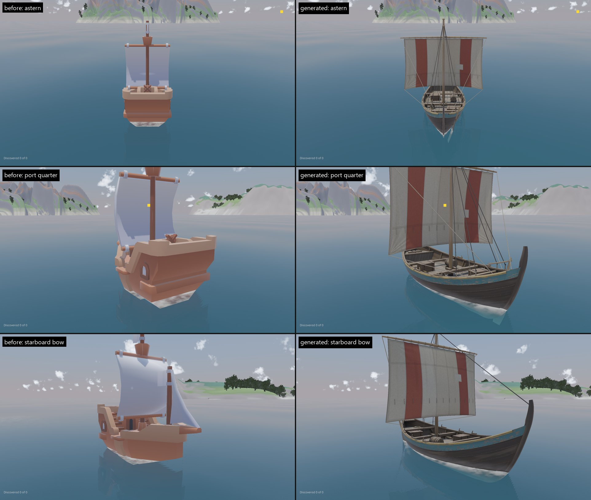
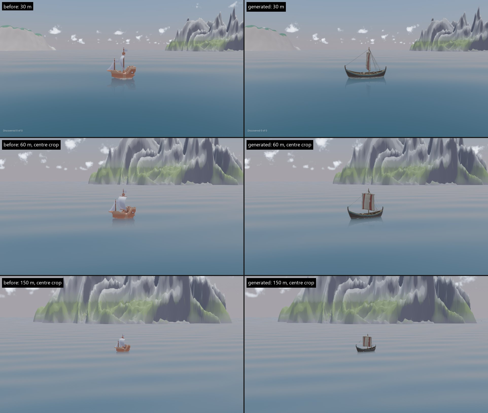
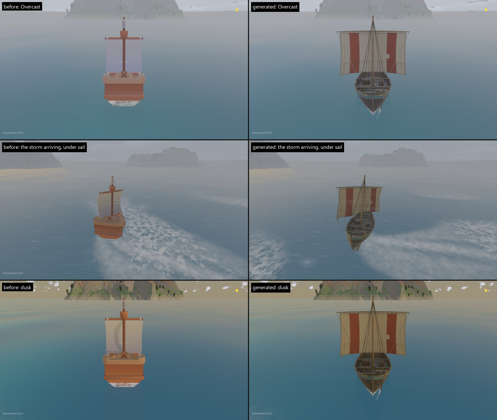
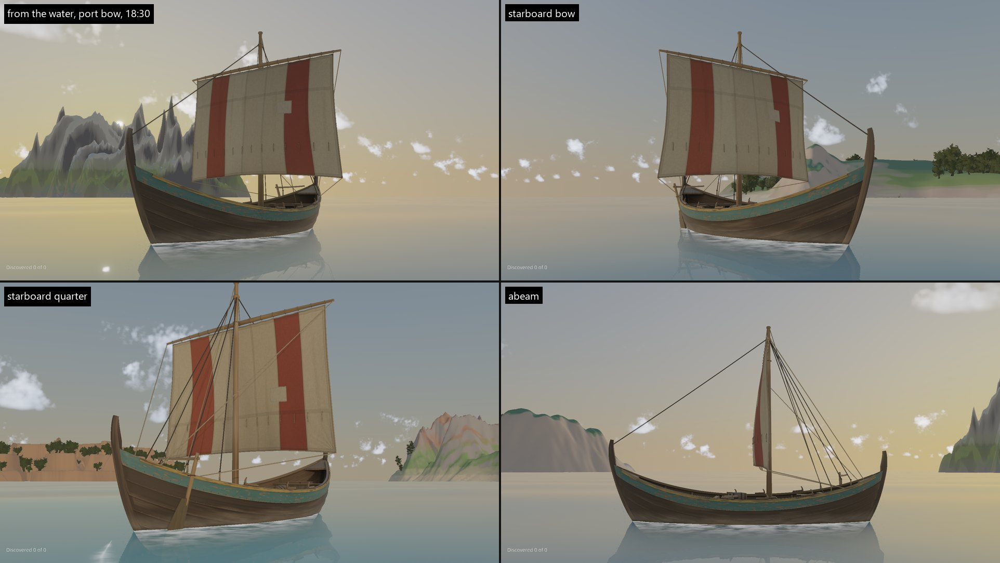
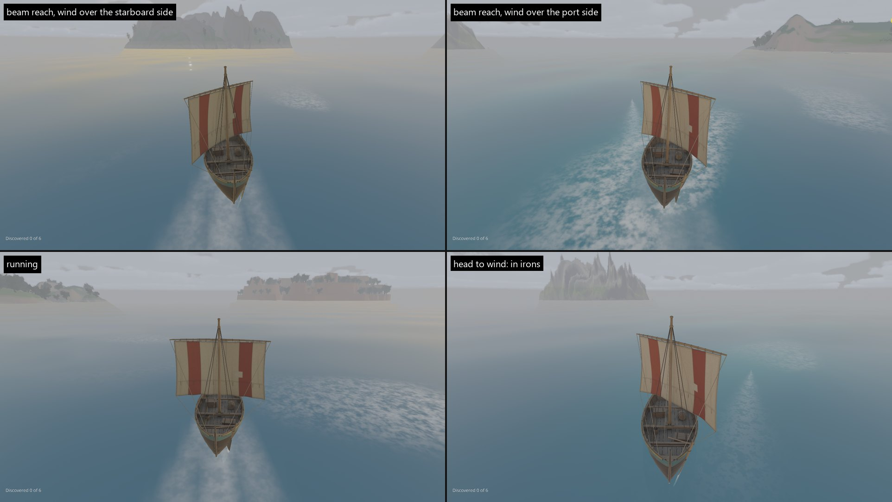
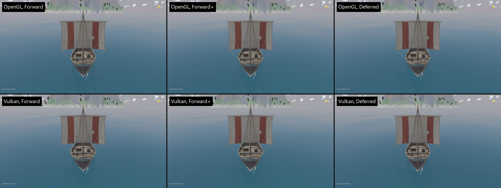
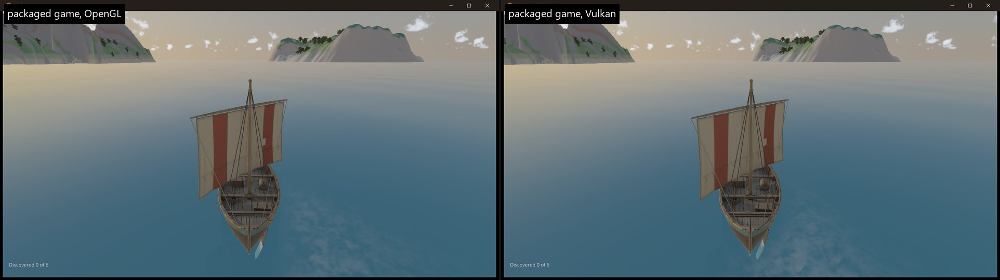
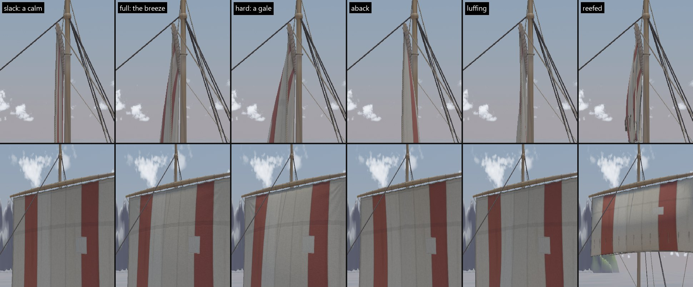

# The Drift boat

The boat you sail in `Scenes/Drift.olo` is `Assets/Models/DriftBoat`: a 7.5 m Nordic clinker boat
with one square sail, generated from nothing by a headless Blender script. This page says what is
in the scene and what has to follow when the boat changes. How the model is built, and the
derivation of every physics number, is in
[the model's README](../../OloEditor/SandboxProject/Assets/Models/DriftBoat/README.md).

It replaced the Kenney kit's `ship-small-hull.glb` and `ship-small-sail.glb`, a low-poly pair with
flat colours and no material maps, drawn at a 0.57 scale to fit the collider. Left: before. Right: the generated boat, same
camera, same weather.

The storm row is from Play, on a beam reach as the weather blends in; the others are the scene as
authored. The generated boat alone, from the water at 18:30:

## What is in the scene

Fourteen entities under the physics root `Boat`:

| entity | what it is |
|---|---|
| `Boat` | the rigid body: box collider, `BuoyancyComponent`, `BoatComponent`, `SailComponent`, `DriftBoatController.lua`. Its origin floats 6 cm above the sea; the collider is offset down onto the hull, and the centre of mass is the collider's middle |
| `Boat Hull` | hull, decks, mast, standing rigging and deck gear: one mesh, three levels of detail (30 860, 8 961 and 2 270 triangles) |
| `Boat Sail` | the yard and sail, origined on the mast. Its Y rotation is `SailComponent`'s yard angle, and its `MorphTargetComponent` holds the cloth's shape |
| `Boat Rudder` | the side rudder on the starboard quarter. Its Y rotation is the helm |
| `Boat Sheet Port` / `Starboard`, `Boat Brace Port` / `Starboard` | one metre of rope each, aimed and stretched every tick from a lead on the gunwale to the sail |
| `Boat Clew Port` / `Starboard`, `Boat Yardarm Port` / `Starboard` | empty children of the sail that mark where each line ends |
| `Boat Clew Port Furled` / `Starboard Furled` | empty children of the sail that mark where each clew is with the sail gathered up to the yard |

The controller script finds these by name. A part it cannot find does not move, and the script
says so once in the log, naming it.

The three render paths on both backends, and the packaged game (run with the model's source folder
renamed away, so its textures can only come from the asset pack):

## The sail is cloth

The sail's mesh carries ten morph targets and `DriftBoatController.lua` blends them every tick from
`SailComponent`: she hangs slack in a calm, fills as the apparent wind rises and bellies hard in a
gale, lies aback against the mast when the wind is on her fore face, shakes when she is luffing, and
is gathered up to the yard as sail is shortened (the automatic reef in a storm included). Before
Play she is drawn as the files hold her, full of a moderate breeze. This is drawing only: the force
is `SailSystem`'s. The targets and how the waves are made are in the model's README.

## Why it is drawn the way it is

- **A square sail on a braced yard is `SailComponent` drawn literally.** The component models one
  sail that braces up to 45 degrees either side and cannot point closer than about 50 degrees to
  the wind. Put through the wind she misses stays and stops in irons at the edge of that zone, sweep
  or no sweep; she changes tack by wearing round (measured: about 55 s under sail, 18 s with the
  sweep, the kit boat the same). A fore-and-aft rig would need a different sail model.
- **The sail deforms through morph targets, not a cloth simulation.** A simulated sheet pinned to a
  yard that swings on a boat doing ten metres a second, with a mast to wrap round and sheets to
  hold its corners, would need pinning and collision the engine's cloth does not have. Blended
  shapes are deterministic, cost one vertex-buffer update a frame, and work on every level of
  detail.
- **The parts are `MeshComponent`s with an authored `LODGroupComponent`**, because `ModelComponent`
  has no levels of detail. Each level is one `.olomesh` naming one single-mesh glTF, and every
  level reuses level 0's texture charts
  ([notes-editor-and-assets.md](../agent-rules/notes-editor-and-assets.md) rule 22).
- **The model's origin is its floating waterline and centre of buoyancy**, not its keel. The hull
  mesh hangs below the physics entity by the height the buoyancy box floats that entity at, with
  no scale, so the drawn waterline meets the sea.

## The rigid body follows the hull

`DriftBoat.rig.json` holds a `physics` block the generator derives from the drawn hull and sail:
collider, buoyancy box, drag, rudder, thrust point and centre of effort. `Drift.olo`'s boat block
and `OloEngine/tests/DriftScenePresets.h` carry the same numbers.

The derivation keeps the game's feel fixed and lets the component values move. `GAME_FEEL` in the
script names what is held: how far a given wind heels her, the side force that knocks her down,
how hard a loaded sail turns her into the wind, surge damping, roll decay, the helm's time constant
and turn rate. The sail's force is therefore not applied at the drawn sail's centre: `SailArea` is
a game number twenty times the drawn canvas, and both its height and its station are set for the
heel and the helm the game was tuned with (the README has the measurements that showed why).
Measured on the old and new bodies, by the sailing tests and in the editor:

| | before | generated boat |
|---|---|---|
| beam reach, Clear / Overcast / Storm wind | 0.63 / 2.59 / 9.56 m/s | 0.63 / 2.59 / 9.62 m/s |
| heel in the 5 m/s breeze / 14 m/s gale | 1.2° / 4.4° | 1.1° / 4.5° |
| under the auxiliary alone | 1.77 m/s | 1.77 m/s |
| held on a beam reach as the storm arrives: share of the leg heeled past 10° (median of six live runs, and the range) | 23% (14 to 55%) | 26% (6 to 41%) |

## When the boat changes

1. Edit `build_drift_boat.py` and regenerate (the command is in the README; about two minutes).
   The script fails if a level of detail's silhouette overlaps level 0's by less than 0.90.
2. Copy the new `physics` numbers into `Drift.olo`'s boat block and `DriftScenePresets.h`.
3. Run `OloEngine-Tests --gtest_filter=DriftBoatDelivery*:DriftSailingTest.*:SailTest.*`.
   `DriftBoatDelivery.TheSceneIsBuiltFromTheGeneratedRig` names each number, line lead and
   level-of-detail entry that disagrees with the rig file;
   `DriftBoatDeliveryPack.TheBoatAndEveryLevelOfDetailSurvivePackaging` loads every level from a
   cooked asset pack.
4. Look at it in the engine. A running editor keeps the old textures until the assets are
   reimported (`olo_asset_reimport`) or the editor is restarted.
5. To check a packaged game, rename `Assets/Models/DriftBoat` away while it runs
   ([notes-editor-and-assets.md](../agent-rules/notes-editor-and-assets.md) rule 23): with the
   folder in place the game reads the textures from the project, not from the pack.

The Kenney pair stays in `Assets/Models/KenneyVehicles` for `OceanCoast.olo` and the test fixtures
that load it.
