# The keeper of Stacks Light

The keeper of Stacks Light watches the boat inside 115 m. Within 62 m in
daylight he waves once. Sail beyond 78 m to reset his greeting. From 18:30
until 06:00 he raises the lantern in his left hand.

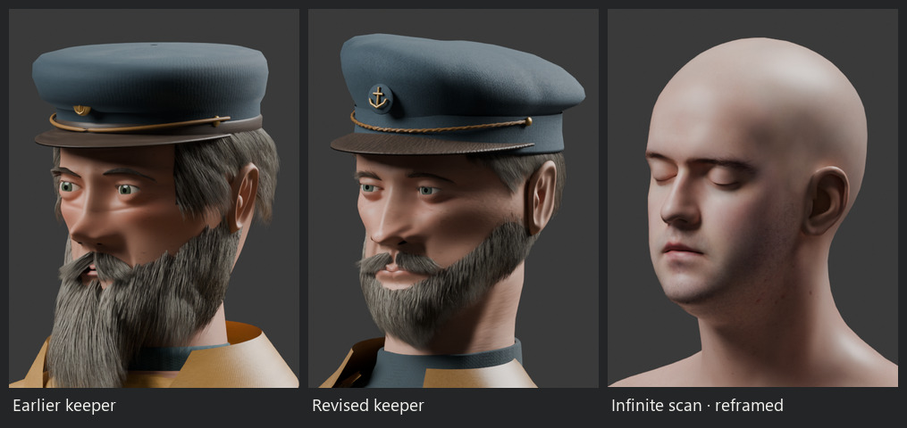

The three-quarter comparison shows the original design, the revised keeper and the
licensed *Infinite, 3D Head Scan*. All three are Blender renders. The scan is
reframed and has closed eyes. Look at the curve from the temple into the eye
socket, the shadow at the nostril and the transition from the lip to the chin.
The shorter beard exposes the keeper's lower face. His lips and moustache still
separate in a hard arc, and the cheeks have a smoother surface than the scan.
The head falls short of the human showcase close-up for #1402. The keeper
appears in Drift, and `DigitalHuman.olo` continues to use the scan.
[Human-head acceptance issue](https://github.com/drsnuggles8/OloEngineBase/issues/1402)

The right panel shows *Infinite, 3D Head Scan* by Lee Perry-Smith
(Triplegangers). Morgan McGuire and Guedis Cardenas converted the files.
Keijiro Takahashi prepared the FBX distribution. The scan and its
render carry CC BY 3.0. [Attribution chain](../../OloEditor/assets/models/InfiniteScanHead/README.md) · [Licence](https://creativecommons.org/licenses/by/3.0/)

## Drawing the figure

Three photographs guided different parts of the design. The keeper's head,
body, skin pigmentation, clothes and fibres were drawn in code. The photographs
were used to compare landmarks and silhouettes.

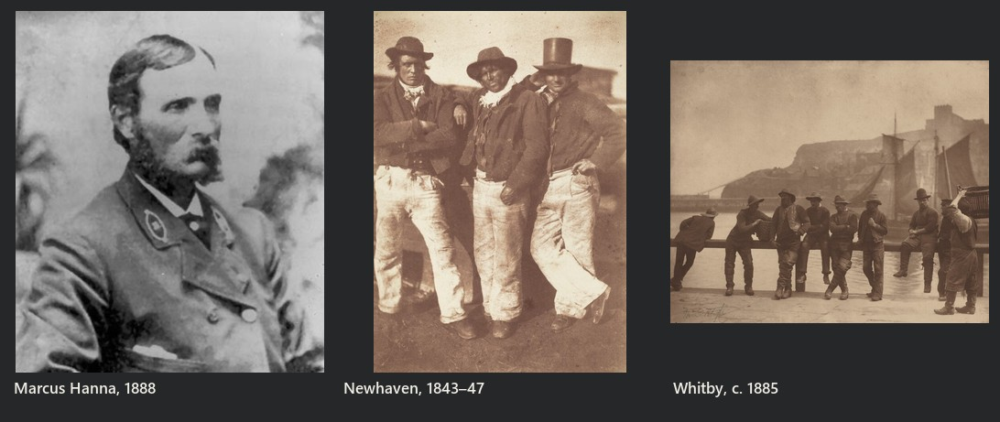

- In the 1888 portrait of Cape Elizabeth keeper Marcus Hanna, the near eye is
  halfway from crown to chin. On a 600-pixel-tall copy the three landmarks fall
  at about 39, 159 and 278 px. The moustache clears the mouth at its centre.
  The raised collar follows the jaw and the shoulder seam slopes away from it.
  [US Lighthouse Society archive](https://archives.uslhs.org/people/marcus-hanna) · [Public-domain portrait record](https://commons.wikimedia.org/wiki/File:Marcus_Hanna,_Lighthouse_keeper_at_Cape_Elizabeth_ME.jpg)
- In Hill and Adamson's Newhaven group (1843–47), the middle man's fingertips
  hang 54% of the way from cap to sole and his jacket ends at 46%. The keeper
  has a longer storm coat, with a doubled yoke across the back and a split front below the lower fastening.
  David Octavius Hill and Robert Adamson, *Alexander Rutherford, William Ramsay
  and John Linton*. National Gallery of Art, Paul Mellon Fund. Public domain.
  [Photograph](https://www.nga.gov/artworks/137713-alexander-rutherford-william-ramsay-and-john-linton)
- Frank Meadow Sutcliffe's *Whitby Fishermen* (c. 1885) shows how much boot
  height varies from man to man. The third standing figure from the left wears
  boots reaching about 41% of his dressed height. Look at the folds above his
  ankles and the way the shaft opens around the knee. The keeper wears a
  shorter boot with his trouser cuffs tucked inside. National Gallery of Art,
  Robert B. Menschel Fund. Public domain.
  [Photograph](https://www.nga.gov/artworks/108746-whitby-fishermen)

Peter Gregory Gallop's late-1800s keeper portrait supplied the high crowned
cap, short peak, badge and long divided beard. On the 340 × 415 px portrait
the pupils are about 63 px apart and the nose base is about 41 px below their
midpoint. The generated face has 64 mm between the pupils and a 232 mm head.
Its standing height is 7.54 heads, close to the seven to seven and a half
used in the Seattle Art Museum's figure-drawing exercise.
[Gallop portrait, National Park Service](https://www.nps.gov/people/petergregorygallop.htm) · [Seattle Art Museum, appendix C](https://www1.seattleartmuseum.org/EuropeanMasters/imgs/KenwoodHouseERG.pdf)

## Revising the head

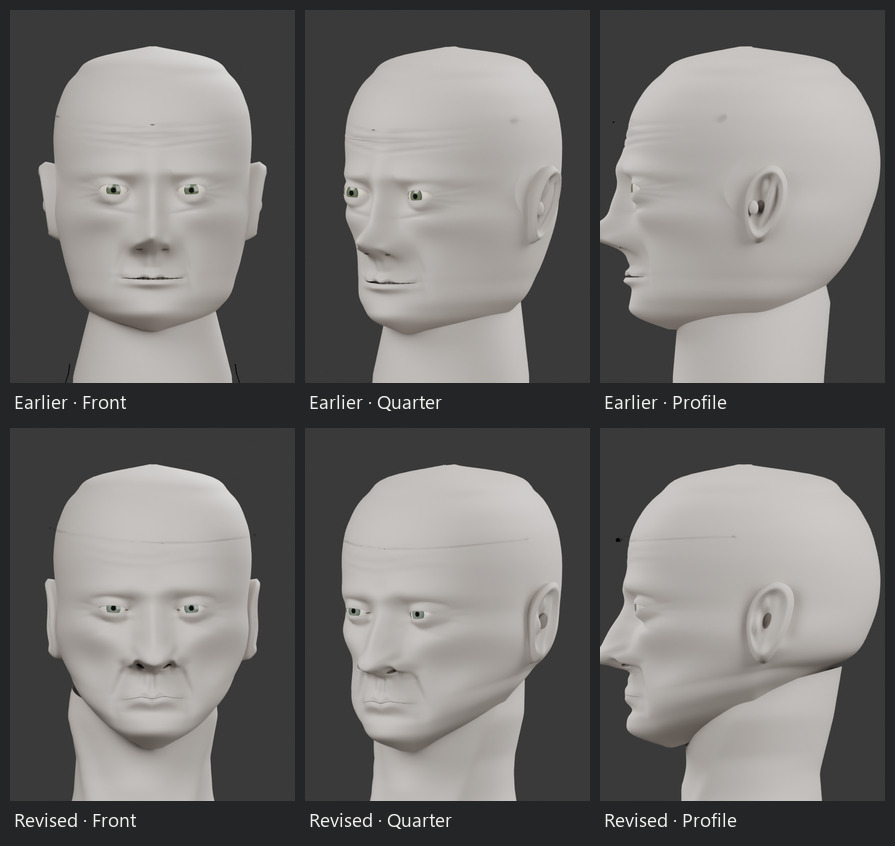

These clay renders use the same camera, scale and lights in each column.
Removing the cap, beard and skin colour reveals why the first face read as a
mask. The cheek stayed almost as broad at the mouth as it was below the eye.
In profile the lower lid projected ahead of the cheek and the nose ended in
a sharp shelf. The revised cheek turns inward towards the mouth, the jaw
narrows before the chin, and the skin folds from each nostril towards the
upper lip. Each 12.6 mm eye sits 3 mm farther back in its socket. A rounded
helix now folds back into the ear bowl. The smooth scalp and near-level
mouth remain conspicuous in the bare front view.

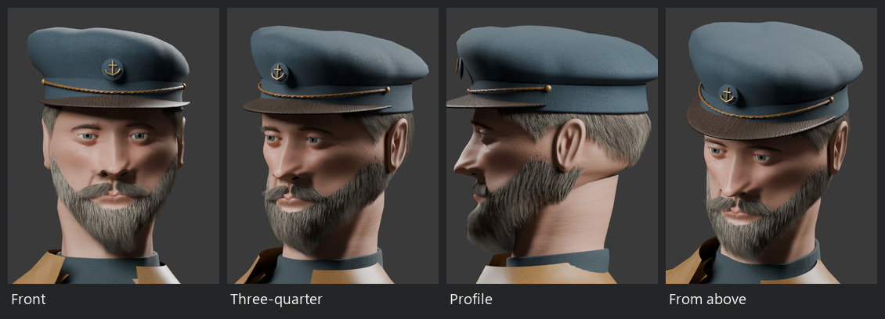

The revision shortened the beard and exposed more of the mouth, lowered the
moustache near the corners and let the ends split into locks. The recipe grows
23,000 beard strands, 3,800 moustache strands, 13,500 scalp hairs, 850 brow
hairs and 270 lashes. In the left blink the left lash roots move a median
3.41 mm. The right lash roots stay still and reopening the eye restores
the starting positions. The beard gains darker roots and silver patches. Its
edge along the cheek is still sharply drawn in profile. Light from above
catches the cloth of the cap and the grain on the leather peak separately.
An earlier profile exposed a step at the temple where the eyelid support
reached the side of the head. Restricting it to the orbit let the hair follow
a continuous surface. The band sits over the upper roots.

## Stance and work clothes

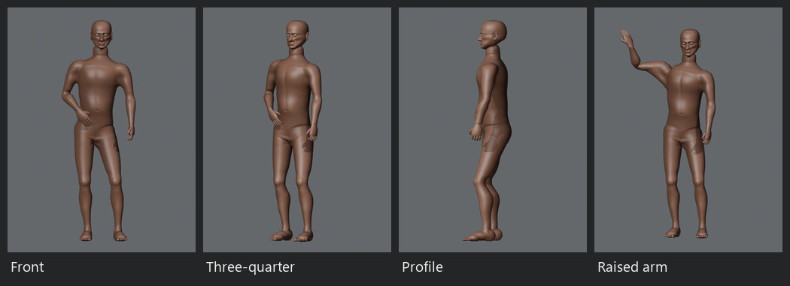

The earlier keeper stood squarely with his arms hanging beside his legs.
The revised pelvis sits 54 mm towards his weight-bearing right boot and
17 mm lower. The left ankle is 58 mm forward of the right in the exported
rest pose. The knees bend to reach the planted soles, the pelvis and chest
turn in opposite directions and the lantern draws the left shoulder lower.
The unclothed study shows how the bare hip, knee and ankle line up under
the uniform. At full wave one edge at the bare armpit stretches by 22.1 mm.

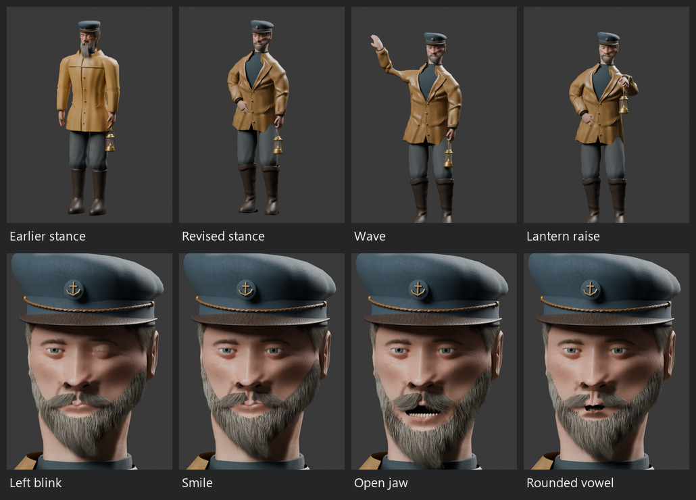

The original coat had a closed front and a separate sleeve that peaked when
the arm rose. Three clothing studies changed the cut. The upper sleeve joins
an oval armhole with a short underarm edge and a long outer edge. Matching
the joint weights on both sides of the elbow closed a 29.49 mm gap in the
bent right sleeve. The gansey's rolled neck follows the shape of the nape. Two open
fronts overlap beneath the buttons, then roll back to show the gansey. Creases
radiate from the waist fastening and welted pockets. The boot shafts turn down
over the tucked trousers. The curved cap crown drops over one temple. Wool,
leather and cotton weave use generic CC0 surface scans. The diamond-pattern
knit and skin pores are procedural. [Surface sources](../../OloEditor/SandboxProject/Assets/Models/DriftKeeper/SurfaceSources.md)

The wave lifts the open right palm. On the left, the modelled fingers curl under
the wire grip. Its midpoint is the lantern pivot, so the lamp can stay upright
as the wrist turns. Each hand has one joint and keeps its finger shape throughout
the gesture. One sharp fold persists at the waved elbow, and the pocket and
cuff corners are stiff. The fitted coat shows its construction more clearly
than it shows years of use.

The blink closes one lid over its globe. At full weight, the largest left-blink
skin displacement in LOD 0 is 4.34 mm. In the open jaw the largest lip
displacement is 17.75 mm and the lower dental arch moves up to 14.04 mm.
The smile lifts the ends of the lips while the cheeks move less. Teeth,
gums and tongue have their own material surfaces. The teeth are unusually
regular and the centre of the rounded mouth retains a pronounced notch.

## Silhouette at distance

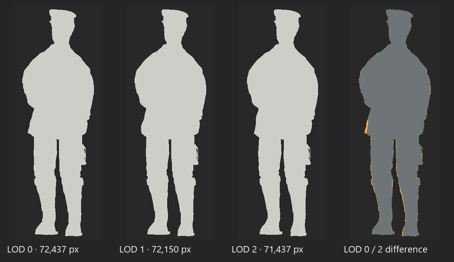

The three body meshes contain 169,320, 47,868 and 20,202 triangles.
The corresponding 520 × 680 orthographic renders cover 72,437, 72,150 and
71,437 pixels at an alpha threshold of one half. Intersection divided by
union is 99.52% for tiers 0 and 1, and 98.56% for tiers 0 and 2. The
fourth panel marks pixels present only in tier 0 in amber and pixels present
only in tier 2 in blue. These measurements include the shared head attachments.
In the game the second tier starts beyond 18 m and the third beyond 78 m.
The silhouette test holds the camera and pose fixed so the change of mesh
is visible at the same scale.

## At Stacks Light

The keeper stands on the second tread below the door. A triangle intersection
check sampled 13 poses in each of the three revised clips and found zero
body intersections with the tower, stairs or rail. A downward ray from
each of 41 low vertices per boot hit the granite. The closest samples were
3.07 mm above the tread on the right and 0.27 mm on the left. Breathing
starts at the spine to keep the boots planted during idle. The tower parents the
keeper. Each eye follows its own bone. A separate head attachment carries
the skin beneath the groom and keeps the same triangle indices across body
LODs. The lamp light follows the wick socket.
[Model contract and regeneration commands](../../OloEditor/SandboxProject/Assets/Models/DriftKeeper/README.md)

## In-engine captures

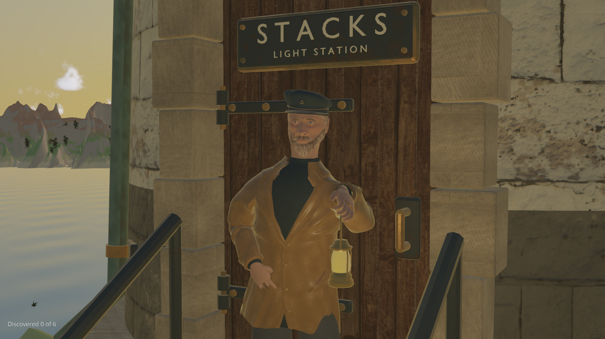

This inspection view came from the packaged OpenGL runtime with the cooking
project’s keeper source folder renamed. The menu’s Continue button restores
the voyage with the boat camera.

From 2.5 m above the water the stack hides the door on some bearings. These
approaches use 225° at 30 m and 240° at 150 m, measured from world +X
towards +Z. Moving the keeper out of frame and back changed and restored
13 of 35 sampled entity IDs at 30 m and 14 of 35 at 150 m. At 30 m the
repeat frame also changed more colour pixels than the removal frame, so the
entity IDs distinguish the keeper from moving water and lighting. At the longer
distance, the coat occupies just a few pixels against the doorway.

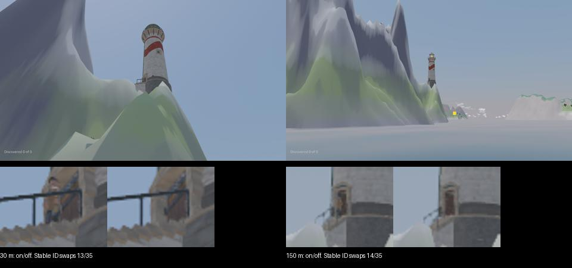

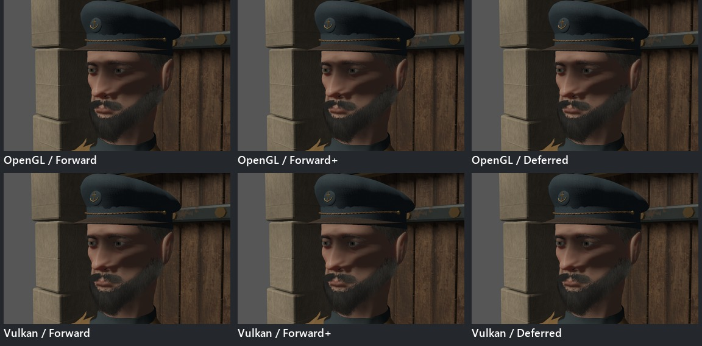

Tower lighting brings out a hard shadow under the cheekbone. In OpenGL
Deferred, hiding the groom changed 88,508 pixels at native resolution,
85,425 with 4× MSAA and 45,302 with Temporal Quality upscale. Each count
excludes pixels that moved by less than 4/255 or at most twice the
repeat-frame difference.

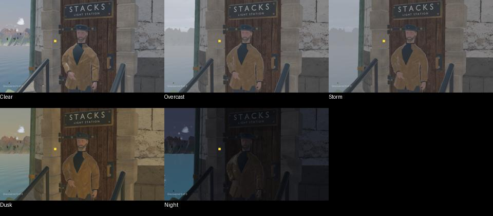
